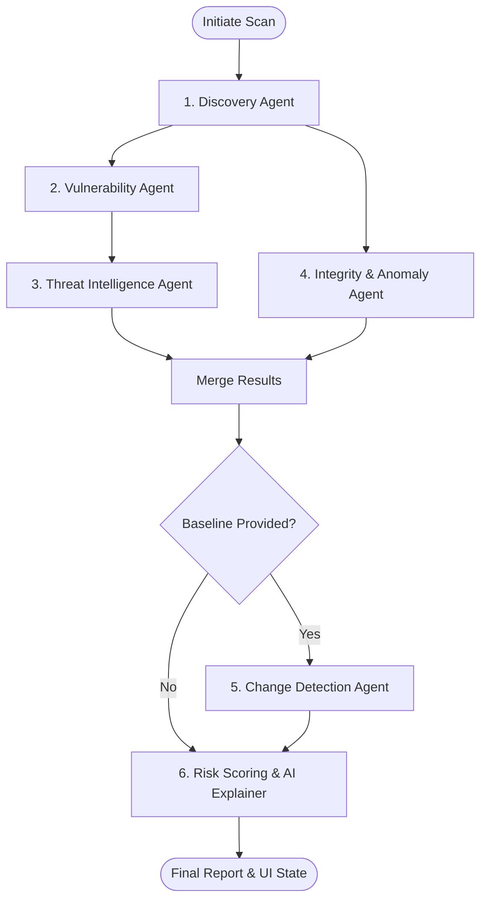

# Software Supply Chain Guardian

### Automated Dependency Analysis, Threat Intelligence, and Verified Remediation

<div align="center">

[](https://www.python.org/)
[](https://github.com/langchain-ai/langgraph)
[](https://deepmind.google/technologies/gemini/)
[](https://cyclonedx.org/)
[](tests/)
[](LICENSE)

**Know what you build. Trust what you ship.**

---

**Amrita Vishwa Vidyapeetham × Bosch Global Software Technologies (BGSW) Hackathon**  
**Team 17:**  
Avinash Pala (BL.EN.U4AIE23062) · Nandana Thachilath M (CB.SC.U4AIE23151) · SriSomesh (CB.AI.U4AID23141)  
Gowtham Kumaresan (CB.AI.U4AID23009) · Vijay Srinivas P (CB.SC.U4AIE23263)

[Overview](#overview) • [Core Design](#core-design-principles) • [Agent Architecture](#agent-architecture) • [Risk Model](#deterministic-risk-scoring) • [Remediation & Sandbox](#remediation-and-sandbox-verification) • [NodeGoat Case Study](#attack-case-study-owasp-nodegoat) • [Quick Start](#getting-started)

</div>

---

## Overview

Modern web and backend applications rarely fail because of custom business logic alone. Roughly 80% to 90% of a production codebase consists of third-party open-source dependencies. When a build server executes `npm install`, it pulls down hundreds of unvetted packages, executes lifecycle scripts, and introduces indirect dependencies several levels deep.

Attackers actively exploit this surface area:
- **Typosquatting:** Registering names with single-character deviations (e.g., `expresss` instead of `express`) to capture accidental developer keystrokes.
- **Malicious Lifecycle Hooks:** Injecting shell commands (`curl ... | sh`, reverse shells, token extractors) into `preinstall` or `postinstall` hooks that trigger immediately during install.
- **Integrity Swaps:** Tampering with package tarball checksums or redirecting download targets away from official registries.
- **Transitive Injection:** Concealing malicious logic inside nested dependencies where conventional direct audits miss them.
- **CI/CD & Container Misconfigurations:** Running Docker containers as `root`, referencing unpinned `:latest` image tags, and using workflow triggers like `pull_request_target` that expose secrets to untrusted forks.

**Supply Chain Guardian** is an automated platform designed to audit, prioritize, and remediate these threats. It performs static dependency resolution, constructs standard CycloneDX SBOMs, checks multiple vulnerability sources, scores risks using a deterministic mathematical model, uses Gemini AI for actionable risk summaries, and verifies fixes inside an isolated Docker sandbox.

---

## Core Design Principles

The platform follows three architectural guardrails:

```
+-------------------------------------------------------------------+
|                        DETERMINISTIC CORE                         |
|  * Static manifest & lockfile parsing (v1, v2, v3)                |
|  * Graph lineage computation (NetworkX directed graphs)           |
|  * Multi-source advisory queries (OSV, GitHub, deps.dev)          |
|  * Real-world threat intelligence (CISA KEV, FIRST EPSS)          |
|  * Strict 0-100 mathematical risk formula                         |
+---------------------------------+---------------------------------+
                                  |
                                  | Verified Evidence & Facts
                                  v
+-------------------------------------------------------------------+
|                        AI REASONING LAYER                         |
|  * Google Gemini Flash via LangChain                              |
|  * Explains attack surface and contextual blast radius in plain text|
|  * Anti-hallucination guardrail: automatically strips fake CVE IDs|
|  * Strict boundary: cannot change risk scores or write raw code   |
+---------------------------------+---------------------------------+
                                  |
                                  | Human Review & Approval
                                  v
+-------------------------------------------------------------------+
|                    SANDBOX VERIFICATION ENGINE                    |
|  * Hardened Docker container (--cap-drop ALL, no-new-privileges)  |
|  * Zero-network runtime import test (--network none)              |
|  * Automated test suite execution & regression verification       |
+-------------------------------------------------------------------+
```

1. **Facts are never generated by AI.** Dependency counts, versions, advisory identifiers, and base risk scores come entirely from deterministic code and authoritative registries.
2. **AI explains, it does not author.** The LLM acts strictly as a security analyst translating verified findings into understandable summaries. An automated guardrail inspects LLM output and strips any advisory ID not present in the verified evidence.
3. **Target code never runs on the host.** Target projects are inspected statically. When verifying fixes, code executes only inside an isolated Docker container with zero network access and dropped privileges.

---

## Agent Architecture

Guardian coordinates six specialized agents using **LangGraph** to handle parallel analysis, retries, and graceful degradation:



### Agent Responsibilities

| Agent | Responsibility | Primary Sources & Mechanisms |
|---|---|---|
| **1. Discovery Agent** | Parses manifests and lockfiles, identifies direct versus transitive dependencies, tags runtime versus dev scope, and generates CycloneDX 1.5 SBOMs. | `guardian/discover.py`, `guardian/sbom.py`, NetworkX, Anchore Syft |
| **2. Vulnerability Agent** | Batches queries to locate known CVEs, GHSAs, and malware records; matches semver ranges; extracts patch versions. | OSV.dev, GitHub Advisory Database, Google deps.dev |
| **3. Threat Intel Agent** | Evaluates active exploitation status and likelihood; checks package maintenance health and licenses. | CISA KEV catalog, FIRST EPSS API, OpenSSF Scorecards |
| **4. Integrity Agent** | Identifies typosquats, dangerous install scripts, unverified registry URLs, tampered hashes, and Docker/CI security flaws. | Damerau-Levenshtein distance, npm downloads API, regex rules, Aqua Trivy |
| **5. Change Detection Agent** | Compares modified code against a trusted baseline to highlight newly added dependencies, altered hashes, or modified scripts. | Differential lockfile engine (`guardian/anomalies.py`) |
| **6. Risk & Explainer Agent** | Calculates deterministic 0-100 risk scores, ranks top findings, and queries Google Gemini for natural-language attack analysis. | Mathematical scoring engine, LangChain, Google Gemini Flash |

---

## Technical Highlights

### 1. Multi-Manifest and Multi-Ecosystem Graph
Guardian processes `package.json` alongside `package-lock.json` (supporting formats v1, v2, and v3). In addition to npm dependencies, the integrated engine (`guardian/deptree/`) traverses Dockerfiles, docker-compose files, GitHub Actions workflows, and secondary ecosystem manifests (Python `requirements.txt`, Go `go.mod`, Java `pom.xml`) into a unified dependency graph.

### 2. Triangulated Vulnerability Scanning
Rather than relying on a single database, Guardian queries three distinct repositories:
- **OSV.dev:** Google's Open Source Vulnerability database.
- **GitHub Advisory DB:** npm advisory bulk queries.
- **Google deps.dev:** Dependency intelligence and cross-ecosystem tracking.

When multiple sources corroborate a finding, Guardian marks the finding with high confidence.

### 3. Anomaly and Tampering Detection
Supply chain attacks often involve zero-day packages with no CVE assigned. Guardian identifies these through structural heuristics:
- **Typosquatting Detection:** Uses Damerau-Levenshtein edit distance against the top 1,000 npm packages (`guardian/data/popular_npm.txt`). To avoid false positives on legitimate similar packages, it queries the public npm downloads API (`api.npmjs.org`); packages with 50,000 or more weekly downloads are whitelisted.
- **Lifecycle Script Inspection:** Inspects `preinstall`, `install`, and `postinstall` directives for suspicious patterns such as `curl ... | sh`, `wget ... | bash`, base64 decoding strings, direct IP addresses, and `child_process` invocations.
- **Registry & Checksum Validation:** Verifies that package tarballs resolve from `registry.npmjs.org` and validates integrity hashes against expected SHA-512 patterns.
- **Container and Workflow Rules:** Statically flags Dockerfiles running as `root`, using unpinned `:latest` tags, and audits GitHub Actions workflows for unsafe triggers like `pull_request_target`.

---

## Deterministic Risk Scoring

Risk scores are not arbitrary AI guesses. They are computed mathematically on a scale of 0 to 100:

$$\text{Base Score} = \begin{cases} \text{CVSS} \times 10 & \text{if CVSS available} \\ 85 / 65 / 40 / 20 & \text{for Critical / High / Medium / Low anomalies} \\ 95 & \text{floor for verified malicious packages / malware} \end{cases}$$

### Score Modifiers

| Condition | Adjustment | Technical Reason |
|---|:---:|---|
| **Production Runtime Package** | +10 | Shipped in the production bundle; directly reachable. |
| **Development-Only Dependency** | -25 | Never shipped to production; lower attack surface. |
| **CI Workflow Exposes Secrets** | +10 | Potential repository credential exfiltration risk. |
| **Direct Dependency** | +5 | Explicitly declared in root manifest. |
| **New Package vs. Baseline** | +10 | Introduced in the current revision; requires scrutiny. |
| **No Published Fix Available** | +5 | Cannot be patched with a simple semver bump. |
| **Listed in CISA KEV** | +15 | Active weaponization documented by security agencies. |
| **EPSS Score >= 50%** | +10 | Statistically high probability of exploit in next 30 days. |
| **EPSS Score >= 10%** | +5 | Moderate exploit probability. |
| **EPSS Score < 1%** | -5 | Very low probability of real-world exploitation. |

**Severity Bands:** Critical (80-100), High (60-79), Medium (35-59), Low (0-34). Every finding stores its exact calculation rationale for complete transparency.

---

## Remediation and Sandbox Verification

Finding vulnerabilities is only half the job. Guardian automates the fix lifecycle while keeping humans in control.

### 1. Minimal Code Interventions
- **Direct Dependencies:** The engine bumps the version constraint directly in `package.json` to the minimum safe version that closes all related advisories.
- **Transitive Dependencies:** Bumping a root dependency often breaks peer packages. Guardian injects precise, version-scoped npm `overrides` into `package.json`:
  ```json
  {
    "overrides": {
      "minimist@1.2.0": "1.2.6"
    }
  }
  ```
  This forces npm to resolve safe versions only where the vulnerable version was required, leaving unrelated trees untouched.

### 2. Human Approval Workflow
Developers view side-by-side unified diffs in the web UI. Each fix displays the target package, current version, proposed version, bump type (patch, minor, or major), and resolved advisories. Developers approve or reject each change; decisions are logged with reviewer identity in `output/<repo>/approvals.json`.

### 3. Isolated Docker Sandbox Verification
Approved fixes are tested in an automated 9-step sandbox pipeline (`guardian/verify.py`):
1. **Prepare:** Applies approved fixes to a temporary sandbox copy (`output/<repo>/sandbox/`). The original repository is never modified.
2. **Lockfile Health:** Executes `npm ls --package-lock-only` to guarantee dependency tree consistency.
3. **Hardened Container Setup:** Launches a Docker container using the app's Node version with `--cap-drop ALL`, `--security-opt no-new-privileges`, and strict CPU and memory limits.
4. **Clean Install:** Executes `npm ci --ignore-scripts` (network active strictly for download; install hooks blocked).
5. **Runtime Loading (`--network none`):** Starts Node.js with **zero network connectivity** and executes `require()` on every single production dependency. If an upgrade introduced a runtime break, it fails here.
6. **Project Test Suite (`--network none`):** Runs the project's native `npm test` without network access.
7. **Usage Analysis:** For major version upgrades, scans the application source code to pinpoint files and line numbers importing the package.
8. **Automated Re-Scan:** Executes all six Guardian agents against the patched sandbox code to verify that target vulnerabilities are closed and no regressions occurred.
9. **Final Verdict:** Generates a verified status: `verified`, `partly fixed`, `new risk`, `regression`, or `build failed`.

### 4. Git Branch Publishing
Once verified, Guardian can publish the changes to Git as two related branches:
- `<prefix>/<repo>-original`: Scanned code and baseline audit reports.
- `<prefix>/<repo>-fixed`: Built on top of original with the fixes, `BEFORE_AFTER.md`, `VERIFICATION.md`, and `remediation.patch`.

Creating a Pull Request from the fixed branch to the original branch shows only the exact security fixes and verification documents.

---

## Attack Case Study: OWASP NodeGoat

To prove the platform under realistic conditions, `scripts/make_scenario.py` establishes a test scenario using [OWASP NodeGoat](https://github.com/OWASP/NodeGoat) (a legacy Node.js/Express application with 1,479 packages and depth 13).

The script injects six simultaneous real-world supply chain attacks into `targets/nodegoat-modified`:

| Target Vector | Injected Modification | Detection Mechanism |
|---|---|---|
| **A. Typosquatting** | `expresss` direct dependency with install script | Identified by Damerau-Levenshtein distance (distance 1 from `express`), download popularity gate, and lifecycle script alert. |
| **B. Malicious Hook** | `postinstall` running `curl ... \| sh` | Flagged by regex pattern match for shell pipe execution during npm hooks. |
| **C. Hash Tampering** | `underscore` integrity hash altered, pointing to external IP | Baseline diff detects altered SHA checksum and non-standard download registry. |
| **D. Transitive Malware** | `flatmap-stream@0.1.1` injected under `express` | Identified by OSV and GitHub Advisory databases as a known malicious package. |
| **E. Container Misconfiguration** | Dockerfile with `node:latest`, running as `root`, `wget \| sh` | Container CI agent flags floating tag, root user execution, and shell execution. |
| **F. Workflow Privilege Leak** | `release.yml` with `pull_request_target` & secret reference | CI workflow audit flags dangerous trigger exposing repository secrets to pull requests from forks. |

---

## Interactive Web Dashboard

Guardian includes a local web application running at **`http://127.0.0.1:8765`**:

- **The Journey:** A narrative walkthrough explaining the scan findings in chronological order.
- **File Explorer:** An interactive JSON tree viewer displaying discovered components and dependency depths.
- **Dependency Graph:** Interactive network graph and radial multi-manifest visualizer.
- **Vulnerabilities Bubble Map:** Visual cluster diagram grouping vulnerabilities by severity, package, and depth.
- **Suspicious Changes:** Forensic view comparing the codebase against the trusted baseline.
- **Fixes Console:** Side-by-side patch viewer with one-click approval controls.
- **Verification Console:** Live terminal logs streaming container builds, runtime load tests, and re-scan results.
- **Report View:** Clean, exportable HTML and JSON security reports.

---

## Getting Started

### Prerequisites
- **Python 3.11 or newer**
- **Git**
- *(Optional)* **Docker Desktop** (required for containerized sandbox verification)
- *(Optional)* **Aqua Trivy** and **Anchore Syft**:
  ```powershell
  winget install AquaSecurity.Trivy Anchore.Syft
  ```

### Installation
```powershell
# Clone the repository
git clone https://github.com/your-org/Supply-Chain-Guardian.git
cd Supply-Chain-Guardian

# Install Python dependencies
python -m pip install -r requirements.txt
```

### Environment Configuration (Optional)
To enable the Gemini AI reasoning layer, create a `.env` file in the root directory:
```env
GEMINI_API_KEY=your_gemini_api_key_here
GEMINI_MODEL=gemini-3.5-flash
```
*Note: If no API key is provided, Guardian automatically falls back to deterministic offline explanations.*

### Running the Web Application
```powershell
.\run_app.ps1
```
Or directly using Python:
```powershell
python -m guardian serve --port 8765
```
Open **`http://127.0.0.1:8765`** in your browser.

### Running a CLI Scan
```powershell
python -m guardian scan `
  --target targets\nodegoat-modified `
  --baseline targets\nodegoat-baseline `
  --top 8
```

### Running the Test Suite
The project includes 83 offline tests covering agent execution, threat intelligence, LLM fallbacks, remediation, and sandbox verification:
```powershell
python -m pytest tests
```

---

## Project Structure

```
Supply-Chain-Guardian/
├── guardian/                      # Core application package
│   ├── agents/                   # LangGraph agent definitions
│   │   ├── discovery.py          # Inventory & SBOM agent
│   │   ├── vulnerability.py      # OSV & GitHub advisories agent
│   │   ├── intel.py              # CISA KEV & EPSS threat intelligence agent
│   │   ├── integrity.py          # Typosquats, scripts, Docker & CI agent
│   │   ├── change.py             # Baseline differential agent
│   │   ├── risk.py               # Risk scoring & AI explanation agent
│   │   └── orchestrator.py       # LangGraph state machine & retry policy
│   ├── deptree/                  # Multi-ecosystem radial dependency graph
│   ├── web/                      # Frontend UI assets (HTML, CSS, JavaScript)
│   ├── static/                   # Static dashboard assets
│   ├── templates/                # Report generation templates
│   ├── data/                     # Popular package lists for typosquatting checks
│   ├── advisories.py             # GitHub Advisory DB integration
│   ├── anomalies.py              # Typosquats, dangerous scripts, baseline diffs
│   ├── cli.py                    # Command-line interface entry point
│   ├── container_ci.py           # Dockerfile and GitHub Actions static analysis
│   ├── depsdev.py                # Google deps.dev API client
│   ├── discover.py               # Manifest & lockfile parser
│   ├── explain.py                # AI prompt construction & anti-hallucination guardrails
│   ├── graph.py                  # NetworkX dependency graph engine
│   ├── llm.py                    # Gemini client with caching and model fallback
│   ├── models.py                 # Core dataclasses (Finding, Component, Evidence)
│   ├── pipeline.py               # Scan pipeline runner with live event streaming
│   ├── publish.py                # Git branch publisher and PR generator
│   ├── remediation.py            # Fix planner and patch generator
│   ├── repo.py                   # Git clone, lockfile resolution, snapshots
│   ├── report.py                 # HTML & JSON report generators
│   ├── risk.py                   # Mathematical risk scoring engine
│   ├── sbom.py                   # CycloneDX 1.5 JSON & Syft cross-check
│   ├── semver.py                 # Semver parsing and version comparison
│   ├── server.py                 # Flask server and REST API
│   ├── threat_intel.py           # CISA KEV and FIRST EPSS clients
│   ├── track.py                  # Before-and-after audit tracking
│   ├── verify.py                 # 9-step Docker sandbox verification engine
│   └── vulns.py                  # OSV.dev batch vulnerability scanner
├── output/                       # Generated reports, SBOMs, snapshots & patches
├── scripts/
│   ├── make_scenario.py          # Injects NodeGoat attack scenario
│   ├── check_llm.py              # Verifies Gemini API connectivity
│   └── list_models.py            # Lists available Gemini models
├── targets/                      # Target repositories (baseline and modified)
├── tests/                        # 83 offline unit and integration tests
├── requirements.txt              # Project dependencies
├── run_app.ps1                   # One-click startup script for web application
├── run_day1.ps1                  # Demonstration CLI scan script
└── README.md                     # Repository documentation
```

---

## Hackathon Scope Coverage

| Requirement | Status | Implementation Details |
|---|:---:|---|
| **Manifest & Lockfile Analysis** | Complete | `guardian/discover.py`, `guardian/deptree/` |
| **CycloneDX 1.5 SBOM Generation** | Complete | `guardian/sbom.py`, output verified with Syft |
| **Interactive Dependency Graph** | Complete | `guardian/graph.py`, NetworkX graph & Deptree visualizer |
| **Container & CI/CD Security Audit** | Complete | `guardian/container_ci.py`, Trivy scan of `node:12-alpine` |
| **Vulnerability Triangulation** | Complete | `guardian/vulns.py`, OSV.dev, GitHub Advisory DB, deps.dev |
| **Supply Chain Anomaly Detection** | Complete | `guardian/anomalies.py`, `popular_npm.txt` |
| **Separation of Evidence vs. AI** | Complete | Green "Verified evidence" vs. purple "AI inference" blocks |
| **Deterministic Risk Scoring (0-100)**| Complete | `guardian/risk.py` (+ CISA KEV & EPSS exploit intelligence) |
| **Human-in-the-Loop Fix Approval** | Complete | `guardian/remediation.py`, `output/<repo>/approvals.json` |
| **Isolated Docker Sandbox Verification** | Complete | `guardian/verify.py` (`--network none`, runtime load test) |
| **Automated Git Branch Publishing** | Complete | `guardian/publish.py`, `guardian/track.py` |

---

<div align="center">
Developed by <b>Team 17</b> for the <b>Amrita × Bosch BGSW Hackathon</b>.<br>
<i>Know what you build. Trust what you ship.</i>
</div>
