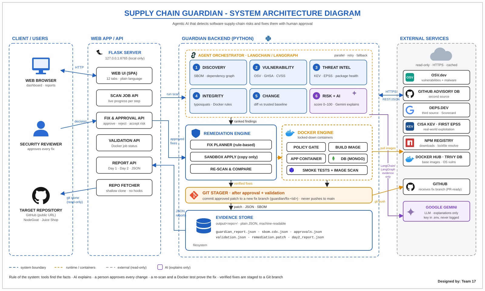

# Software Supply Chain Guardian (Team 17)

*Know what you build. Trust what you ship.* Amrita × Bosch BGSW Hackathon.

**Team 17:** Avinash Pala (BL.EN.U4AIE23062) · Nandana Thachilath M (CB.SC.U4AIE23151) ·
SriSomesh (CB.AI.U4AID23141) · Gowtham Kumaresan (CB.AI.U4AID23009) · Vijay Srinivas P (CB.SC.U4AIE23263)

## What it does
> *Show us what is in the application, what changed, and what appears risky.*

Paste a public GitHub URL (or pick NodeGoat / Juice Shop). Guardian reads the repository's manifests and lockfiles,
builds the full dependency graph and SBOM, checks every package against several free vulnerability and threat-intel
sources, looks for supply-chain tampering, compares against the last known-good scan, scores every finding with a
deterministic risk model, and has Gemini explain the top findings in plain English from the evidence only.

| Requirement | Where it is covered |
|---|---|
| Analyse manifests and lockfiles; direct and transitive deps; names and versions | `guardian/discover.py` |
| SBOM (CycloneDX) | `output/<repo>/sbom.cdx.json` (`guardian/sbom.py`), cross-checked with **Syft** |
| Dependency graph; where each component comes from | `guardian/graph.py`, the Full graph and Risk paths tabs |
| Inspect container images and CI/CD workflows | Dockerfile rules, a **Trivy** base-image scan, GitHub Actions rules (`guardian/container_ci.py`) |
| Known vulnerabilities: CVE, severity, fixed versions; trace transitive deps to source | OSV.dev, GitHub Advisory DB, deps.dev; every finding carries its dependency path(s) |
| Supply-chain anomalies | typosquat, install script, integrity change, non-registry source, injected transitive dep, `pull_request_target`, `curl \| sh` (`guardian/anomalies.py`) |
| Present evidence: component, path, evidence, risk level | the web app + `output/<repo>/guardian_report.json` |
| Separate verified evidence from AI inference | green "Verified evidence" vs purple "AI inference" blocks; the JSON has separate `evidence` and `ai` fields |

## Architecture



- **Client / users:** a web browser for the dashboard and reports; the target repository is cloned read-only.
- **Web app / API:** a local Flask server (`127.0.0.1:8765`) serving the single-page UI, the scan job API (live
  progress per step), the report API and the repo fetcher (shallow clone, no hooks).
- **Guardian backend:** six agents orchestrated with LangGraph, plus the evidence store in `output/<repo>/`.
- **External services:** read-only HTTPS, cached: OSV.dev, GitHub Advisory DB, deps.dev, CISA KEV, FIRST EPSS,
  the npm registry, Docker Hub / Trivy DB, and Google Gemini (explanations only).

### Six agents, orchestrated with LangGraph

```
START → [1] Discovery ─┬─► [2] Vulnerability ─► [3] Threat intelligence ─┬─► merge ─(baseline?)─► [5] Change detection ─► [6] Risk & explanation → report
                       └─► [4] Supply-chain integrity ───────────────────┘        └──(no)───────────────────────┘         (Gemini via LangChain)
```

| Agent | Job | Sources / tools |
|---|---|---|
| 1 Discovery | inventory, dependency graph, SBOM, full multi-manifest graph | lockfile parser, networkx, CycloneDX, Syft, deptree |
| 2 Vulnerability | CVE / GHSA / malware per name@version, cross-checked across 3 sources | OSV.dev, GitHub Advisory DB (npm bulk API), deps.dev |
| 3 Threat intelligence | real-world exploitation and package health | CISA KEV, FIRST EPSS, deps.dev (deprecation, licenses, OpenSSF Scorecard) |
| 4 Supply-chain integrity | typosquats, install scripts, sources, hashes, Dockerfile and CI rules | rapidfuzz + npm downloads, rules, Trivy |
| 5 Change detection | what is new since the last known-good copy (runs only with a baseline) | lockfile diff, baseline re-scan |
| 6 Risk & explanation | deterministic 0-100 score, then Gemini explains the top findings | risk model, `langchain-google-genai`, guardrails |

All external sources are free and need no API key (Sonatype OSS Index was evaluated but now requires an account).
The risk score uses exploit intelligence: +15 if the CVE is in CISA KEV, +10/+5 for EPSS ≥ 50% / ≥ 10%, -5 for EPSS < 1%,
and confidence is "High (2 sources)" when two advisory databases agree.

**Failure handling.** Network agents retry with backoff (LangGraph `RetryPolicy`). If one advisory source fails, the
others' results are kept and a warning is recorded. If an agent still fails, it degrades: its step shows a clear error,
the scan continues, and the results page shows a "Partial results" bar. Only a discovery failure stops the scan, with
the failed step named. The AI step has a hard time budget (45 s per call, 60 s in total, set with
`GEMINI_CALL_TIMEOUT` / `GEMINI_TOTAL_TIMEOUT`): an overloaded model is skipped for the next one, and if none answers
in time the deterministic explanations are used, so a slow AI never stops a scan from finishing and being saved.

**Tests.** `python -m pytest tests` runs 88 offline tests (all external services are faked): semver matching, advisory
cross-checks, KEV/EPSS enrichment, risk scoring, agent order and parallelism, retries and degradation, baseline
detection, the Gemini client (model fallback, time budget, key redaction), the Flask API, and an end-to-end scan.

Design rules:
- **Scores and facts come only from deterministic tools.** The LLM explains and never scores.
- **Nothing from the target is installed or executed.** We parse files only.
- **The tampered scenario is local only.** Nothing is pushed or published, and the injected URLs use reserved addresses (`203.0.113.0/24`, `*.example`).
- **Secrets stay in `.env`**, which is git-ignored and never written to reports.

## Target application
[OWASP NodeGoat](https://github.com/OWASP/NodeGoat) (upstream commit `c5cb68a`): Node.js/Express with
`package-lock.json` v2 (1,479 packages, depth 13), a multi-stage `Dockerfile` and 2 GitHub workflows.

`scripts/make_scenario.py` creates:
- `targets/nodegoat-baseline`: an untouched copy.
- `targets/nodegoat-modified`: the same app with simulated supply-chain attacks:
  | # | Injected change | Expected detection |
  |---|---|---|
  | A | `expresss` typosquat direct dependency with install script | typosquat + install script + new dependency |
  | B | `postinstall` that runs `curl … \| sh` | dangerous lifecycle script |
  | C | `underscore` integrity hash + registry changed, same version | integrity change + non-registry source |
  | D | `flatmap-stream@0.1.1` (real 2018 malware) injected under `express` | OSV malicious package + new transitive dep |
  | E | Dockerfile `node:latest`, `wget … \| sh`, root user | container rules |
  | F | `release.yml` with `pull_request_target` + unpinned 3rd-party action + secret | CI rules |

## Setup
Prerequisites: Python 3.11+, git, and optionally Trivy and Syft
(Windows: `winget install AquaSecurity.Trivy Anchore.Syft` · macOS: `brew install trivy syft`).

```bash
python -m pip install -r requirements.txt
# optional AI layer: create .env (never commit it)
#   GEMINI_API_KEY=...
#   GEMINI_MODEL=gemini-3.5-flash
#   GEMINI_FALLBACK_MODELS=gemini-3.5-flash,gemini-3.1-flash-lite   (optional; used on 404/503/429)
python scripts/check_llm.py    # verify key + model (never prints the key)
python scripts/list_models.py  # list Flash models available to your key
```

**Interactive web app (recommended for the demo):**
```bash
python -m guardian serve --port 8765    # Windows: .\run_app.ps1
```
Open http://127.0.0.1:8765, paste a GitHub URL or pick NodeGoat / Juice Shop. The landing page starts a live scan,
shows each step in plain language, and then opens the results:

| Tab | What it shows |
|---|---|
| Overview | the guided journey: get the code → ingredient list → family tree → known-bad lists → tampering → compare → AI → verdict |
| All Findings | every finding with its risk score, evidence, dependency path and AI explanation |
| Vulnerabilities | known CVEs / GHSAs / malware per package, with sources, KEV and EPSS |
| Suspicious Changes | supply-chain anomalies as case files (typosquats, scripts, integrity, Docker, CI) |
| Full graph | every manifest in the repository in one radial graph (see below) |
| Risk paths | the dependency paths from the app to each risky package |
| Agents | the six agents: timeline, inputs and outputs, LLM model, token usage and guardrail results |
| Final Report | the full written report, downloadable |
| More | Files (JSON tree viewer), How We Discovered, Supply Chain, Dependency Graph (tree/network) |

Repos without a lockfile are resolved with `npm install --package-lock-only --ignore-scripts` (no code runs).
Each scan of a GitHub URL is saved under `output/<repo>/`, and the next scan of the same repo shows what changed.

**Full Graph tab.** Every scan also maps every manifest in the repository (npm, Dockerfiles,
docker-compose, GitHub Actions, plus Python/Go/Java/Ruby/PHP/Rust/.NET when present) into one radial graph:
project → ecosystem → manifest → packages by depth. Node size is the number of dependents, and colour is the
worst Guardian finding on that package. Click a node to see every path to it, its evidence, and its findings.
The engine is vendored in `guardian/deptree/` and writes `output/<repo>/deptree_graph.json` (npm graphs are
cross-checked with `npm ls`). If it fails, the rest of the scan is unaffected.

Manual CLI run and options:
```bash
python -m guardian scan --target targets/nodegoat-modified --baseline targets/nodegoat-baseline \
       [--syft] [--top 8] [--no-llm] [--no-trivy] [--fail-on-critical]
```

## Outputs
| File | Content |
|---|---|
| `output/<repo>/guardian_report.json` | Machine-readable report (`supply-chain-guardian/report/v1`) |
| `output/<repo>/sbom.cdx.json` | CycloneDX 1.5 SBOM |
| `output/<repo>/deptree_graph.json` | Full multi-manifest dependency graph |
| `output/<repo>/sbom.syft.cdx.json` | Independent Syft SBOM (cross-check, with `--syft`) |
| `output/<repo>/trivy-image-*.json` | Raw Trivy base-image scan |

## Risk score
`base` = CVSS×10 (vulns) or severity (85/65/40/20) · malicious package → floor 95 · **+10** runtime (in prod image) ·
**−25** dev-only · **+10** CI step with secrets · **+5** direct dependency · **+10** new vs baseline · **+5** no fix ·
KEV / EPSS adjustments as above. Levels: ≥80 Critical, ≥60 High, ≥35 Medium, ≥15 Low. The rationale is stored on every finding.

## Responsible AI and security
- The LLM receives only the top-N findings' verified evidence (no source code, no secrets) in a single request, cached on disk under `.cache/llm`.
- The prompt forbids adding facts. Advisory IDs that are not in the evidence are removed automatically and listed.
- If the API fails, is overloaded or runs out of its time budget, a deterministic template is used and the report says so.
- The AI never changes scores, files or dependencies.

## Known limitations
- Vulnerability matching is npm only (lockfile v2/v3); other ecosystems appear in the Full graph but are not yet matched against advisories.
- No reachability analysis yet.
- The typosquat reference list is curated (`guardian/data/popular_npm.txt`). Lookalikes with ≥50k weekly downloads are treated as legitimate.
- `node:latest` is flagged but not scanned (a floating tag gives a non-reproducible result).
